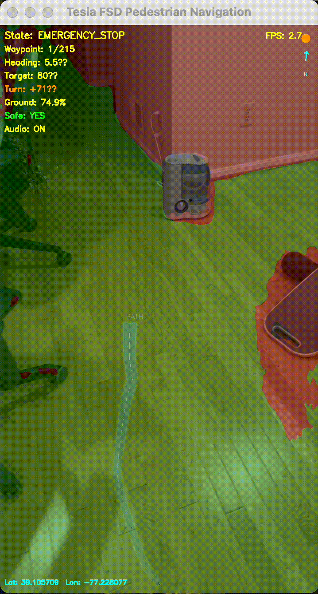

# SafeStride

An AI-powered navigation system designed to provide the visually impaired with real-time environmental awareness and navigation guidance.

## Features

### Voice Interaction
- Gemini Live voice agent
- Real-time environmental description and guidance
- Context-aware assistance based on camera footage

### Smart Navigation
- Tesla-style path generation
- Custom obstacle detection using [Roboflow](https://roboflow.com) model
- Ground segmentation with [Segformer-B0](https://github.com/NVlabs/SegFormer)
- Spatial audio directional cues
- Google Maps API for turn-by-turn walking directions

### iOS App
- **Mute Button**: Control voice input
- **Camera Button**: Toggle visual context
- **Server Button**: Connect to navigation backend
- **GPS Arrow**: Connect backend to location data
- **Chat Button**: Open conversation history to share with assistants
- **End Call Button**: Terminate session
- Smooth location and video streaming with navigation backend

## Gemini Live Voice Agent

Location: "ai-agent-gemini-live/"

Google's Gemini Live model serves as the app's voice agent, hosted on [LiveKit](https://livekit.io).

## Swift iOS App

Location: "ai-agent-swift-app/"

The primary user interface, integrating voice AI and navigation capabilities.


## Python GPS Navigation Backend

Location: "roboflowpathgps.py"

The intelligent navigation system that processes visual data and provides path guidance.

## Setup

1. Clone the repository
   ```bash
   git clone https://github.com/yourusername/I_Cant_See.git
   cd I_Cant_See
   ```

2. Set up Python backend
   ```bash
   pip install -r requirements.txt

   # Configure API keys in roboflowpathgps.py
   API_KEY = "YOUR_GOOGLE_MAPS_KEY"
   ROBOFLOW_API_KEY = "YOUR_ROBOFLOW_KEY"
   ROBOFLOW_PROJECT_ID = "YOUR_ROBOFLOW_ID"
   ```

3. Set up Gemini Live Agent
   ```bash
   cd ai-agent-gemini-live
   # Follow the LiveKit setup instructions in ai-agent-gemini-live/README.md
   ```

4. Set up iOS App
   ```bash
   cd ai-agent-swift-app
   open VoiceAgent.xcodeproj
   # Configure your development team in Xcode
   ```

## Usage

1. Start  Python backend
   ```bash
   python roboflowpathgps.py
   ```

2. Launch the Gemini Live Agent
   ```bash
   cd ai-agent-gemini-live
   # Follow run instructions
   ```

3. Run iOS App
    - Open the project in Xcode
    - Connect your iOS device
    - Build and run (⌘R)

4. Use the App
    - Grant camera and microphone permissions
    - Use the Camera button to enable visual assistance
    - Tap the Server button to connect to the backend
    - Tap GPS Arrow to send location data
    - Speak naturally with the voice assistant
